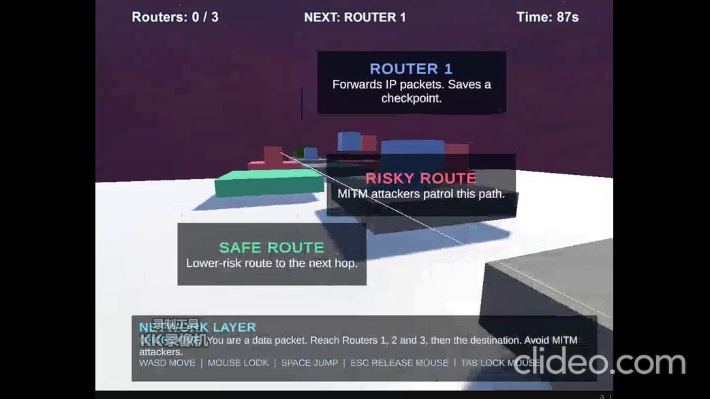
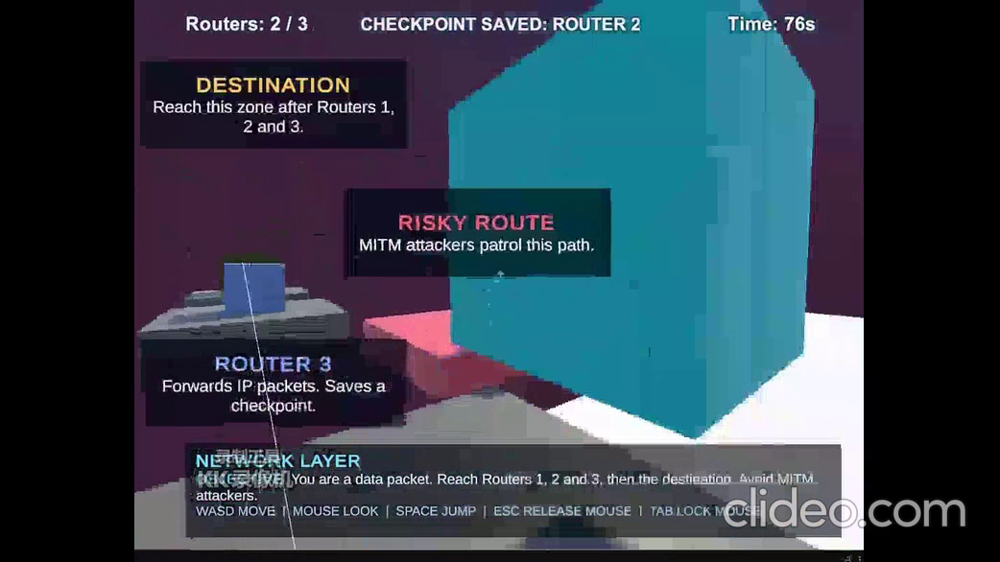
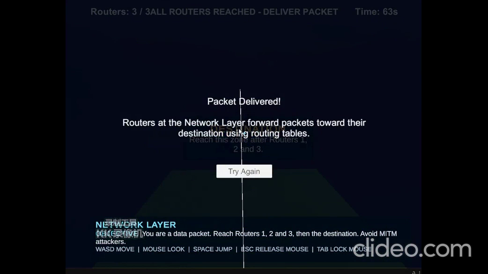
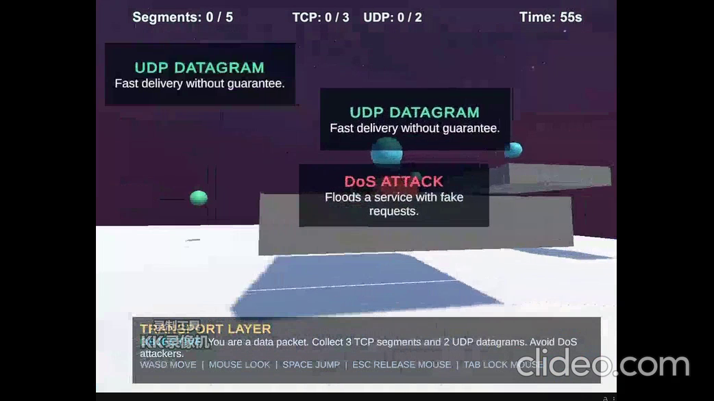
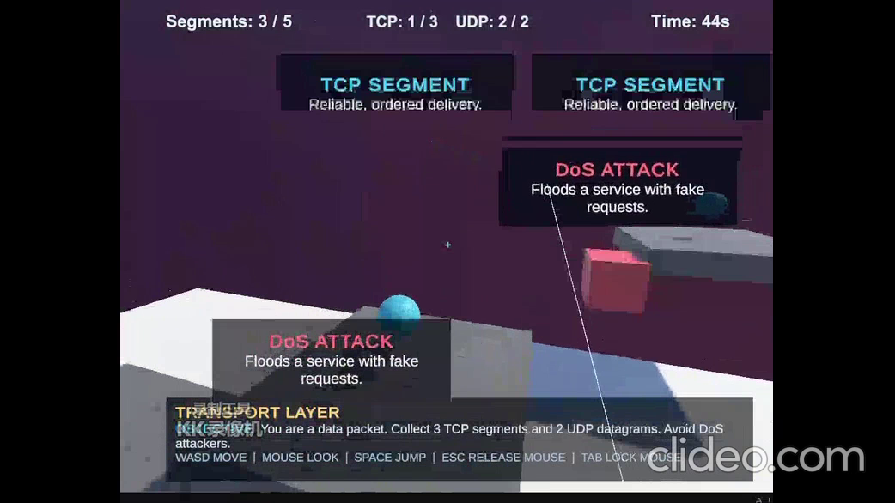
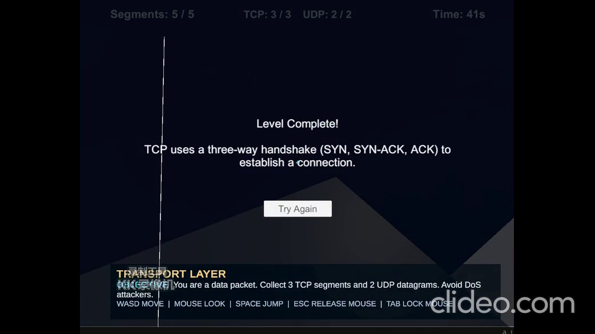

# Gameplay screenshots

Frames extracted from the supplied Network Layer and Transport Layer demo videos.
Original frame dimensions: 1042 x 586. No resizing, cropping or retouching applied.
The recordings include a watermark, editor gizmos and some overlapping UI text.
These images document the supplied recordings. The team recommends a 1200 x 700 game canvas.
Source timestamps are recorded in frames.json.

## Network Layer

## Transport Layer

